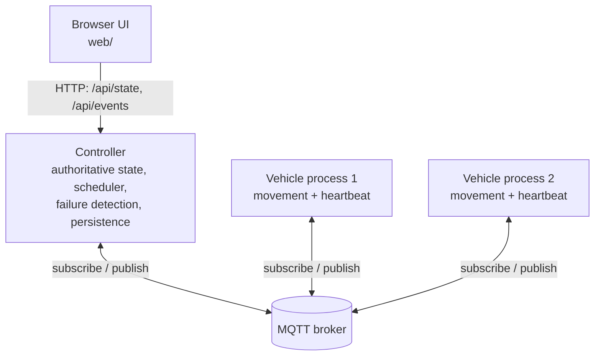

# Fault-Tolerant Fleet Manager

A small Go distributed-systems project that simulates vehicles completing tasks on a 2D grid. The focus is on coordination when messages are delayed, duplicated, dropped, or processes become unavailable—not on route optimization.

Vehicles and the controller communicate through an MQTT broker. A browser UI visualizes the simulation.

## Features

- Independent Go controller and vehicle processes
- MQTT publish/subscribe messaging with JSON payloads
- Vehicle movement and periodic heartbeat/position updates
- Synchronised startup: vehicles register first and wait for a start signal from the controller
- Task assignment and reassignment
- Heartbeat-based failure detection
- Reconciliation of stale vehicles: the controller stops a vehicle that moves without a task assigned to it
- Message fault injection: drop, delay, duplicate, and reorder
- Controller state persistence and recovery
- Browser-based fleet visualization with a live controller event log

## Architecture



The broker transports messages; it does not own fleet state. The controller is the source of truth for vehicle status, positions, task state, and assignments.

Typical message flow:

- At startup, every vehicle publishes a registration heartbeat (sequence 0) and waits. The controller knows the vehicles from the scenario file and starts them all together: once every listed vehicle has registered, it publishes a retained `start` message.
- After the start signal, vehicles publish a heartbeat every second, including their current position, the task they are executing, and a sequence number.
- The controller consumes heartbeats, updates its state, and detects task completion or vehicle timeouts. A vehicle that moves without a task assigned to it is told to stop.
- The controller publishes task assignments and stop commands on vehicle-specific topics.
- The UI polls the controller's HTTP API for the current simulation state and for the controller's event log.

## Quick start (Docker)

The only requirements are [Docker](https://docs.docker.com/get-docker/) with Compose and a modern browser. From the repository root:

```bash
docker compose up --build
```

This builds the Go programs and starts the MQTT broker, the controller, three vehicles, and the web UI. The vehicles stay put until all three have registered with the controller, which takes a moment. Then open <http://localhost:8000>. The controller's HTTP API is published on <http://localhost:8080> (`/api/state` and `/api/events`), and the broker on port 1883.

Stop everything with `Ctrl+C`, and remove the containers with `docker compose down`.

## Scenarios

A scenario is a JSON file in [`scenarios/`](scenarios/) that defines where the vehicles start, which tasks exist, and which messages to drop, delay, or duplicate. The controller and every vehicle load the same file. Without further configuration, [`scenarios/no_faults.json`](scenarios/no_faults.json) runs.

### Run a scenario

Pick a scenario with the `SCENARIO` environment variable, as a path relative to the repository root:

```bash
SCENARIO=scenarios/task-hot-potato.json docker compose up --build
```

Then open <http://localhost:8000>. The `scenarios/` directory is mounted into the containers, so editing a scenario file does not need `--build`. The controller and the vehicles keep their state in memory, so run `docker compose down` before repeating or switching a scenario to start from scratch:

```bash
docker compose down
SCENARIO=scenarios/zombie-steals-completion.json docker compose up
```

To pin a scenario, put `SCENARIO=scenarios/<file>.json` in a `.env` file next to `docker-compose.yml`.

Without Docker, pass `-scenario scenarios/<file>.json` to the controller and to every vehicle.

Startup order does not matter. The controller registers the vehicles listed in the scenario as `NOT_READY`, and each vehicle announces itself with a heartbeat that has sequence 0 and then waits. When every listed vehicle has announced itself, the controller publishes a retained `start` message and all vehicles begin moving at about the same moment. The registration heartbeat is never dropped or delayed; faults apply from heartbeat 1 on. This is what makes a scenario play out the same way on every run, and all times below are measured from the start signal.

The broker keeps the `start` message for as long as it runs. A vehicle that connects to a broker left over from an earlier run starts at once, before the controller has registered the whole fleet. That is one more reason to run `docker compose down` between scenarios, which also removes the broker.

### Scenario file format

```json
{
  "vehicles": [
    { "id": "vehicle-1", "start_x": 10, "start_y": -10 }
  ],
  "tasks": [
    { "id": "task-1", "destination": { "x": 10, "y": 5 } }
  ],
  "controller_faults": [
    { "action": "drop", "vehicle_id": "vehicle-1", "sequence": 1 }
  ],
  "vehicle_faults": [
    { "action": "delay", "vehicle_id": "vehicle-1", "sequence": 3, "delay_ms": 2000 }
  ]
}
```

| Field | Meaning |
|---|---|
| `vehicles` | The vehicles of the scenario, each with a start position. The controller only accepts vehicles listed here and waits for all of them before it starts the fleet, so list every vehicle that runs: Compose runs `vehicle-1`, `vehicle-2` and `vehicle-3`. A vehicle process that is not listed starts at its `-startX`/`-startY` flags (default `0,0`), but the controller ignores its heartbeats. |
| `tasks` | Tasks created when the controller starts, each with a destination on the grid. |
| `controller_faults` | Faults on messages the controller sends to vehicles: task assignments and stop commands. `sequence` counts those messages per vehicle, starting at 1. |
| `vehicle_faults` | Faults on heartbeats a vehicle sends. `sequence` is the heartbeat number, starting at 1. |

Each fault has an `action` (`drop`, `delay`, or `duplicate`) and optionally:

- `vehicle_id`: the vehicle the rule applies to. Empty means all vehicles.
- `sequence`: the message the rule applies to. Omitted or `0` means every message.
- `delay_ms`: required for `delay` and must be greater than 0.

If several rules match one message, `drop` wins over `delay`, and `delay` wins over `duplicate`. A rule with a `sequence` affects exactly one message, so a longer outage is written as one rule per heartbeat.

Timing to keep in mind when reading a scenario:

- A vehicle moves one cell per second, first along x, then along y, and sends a heartbeat every second. Heartbeat *N* leaves about *N* − 1 seconds after the start signal.
- The controller marks a vehicle `OFFLINE` after more than 3 seconds without a heartbeat and puts its task back in the queue, provided that task is still assigned to that vehicle.
- The controller assigns queued tasks to the nearest idle vehicle every 0.5 seconds.
- If a heartbeat does not carry the task the controller assigned, the controller assumes the assignment was lost and puts the task back in the queue. If the heartbeat names a different task, the vehicle is also told to stop.
- If the controller has no task assigned to a vehicle and the vehicle has moved since its last accepted heartbeat, the vehicle is told to stop. This is how a revived vehicle that kept working on a reassigned task, or one that received an obsolete assignment, is brought under control.

### Reading the web UI

The UI shows the controller's view, not the vehicles' real state.

- The **Vehicles** table lists each vehicle's last reported position, its status (`NOT_READY`, `IDLE`, `WORKING`, or a red `OFFLINE`), and the task the controller thinks it has. `NOT_READY` means the scenario lists the vehicle but it has not registered yet. If one vehicle stays `NOT_READY`, the fleet never starts.
- The **Tasks** table lists each task's status (`QUEUED`, `IN_PROGRESS`, `COMPLETED`) and the vehicle it is assigned to.
- On the grid, every vehicle is a coloured circle. While the controller thinks a vehicle is working on an in-progress task, a line leads from the vehicle to the task's ✕.
- Every task that is not completed has a ✕ at its goal, labelled with the task id. It is grey while the task is `QUEUED` and takes the assigned vehicle's colour while the task is `IN_PROGRESS`. A completed task's ✕ disappears.
- The number inside a vehicle is the last heartbeat sequence the controller accepted. A jump, such as 5 to 8, means heartbeats were lost on the way.
- A ring pulses out from a vehicle each time the controller receives a heartbeat from it. A duplicated or late heartbeat also pulses, but does not change the number.
- A grey circle with a red ✕ means the controller has marked the vehicle `OFFLINE`. It clears with the next heartbeat.
- The **Event log** sits next to the grid, or below it on a narrow screen, and lists the newest event first. It shows what the controller does: each assignment with its generation, each stop command with the reason, vehicles it marks offline, completed tasks with the vehicle that completed them, errors, and the faults it injects into its own messages. The time on the left (`+12.4s`) counts from the first message the controller received. Hover over a row for the wall-clock time.
- The event log does not list heartbeats, because the grid already shows them. Faults injected on the vehicle side are not logged by the controller either; they show up only as gaps in the sequence numbers.

The controller keeps its last 500 events, heartbeats included, and serves them at <http://localhost:8080/api/events>. It prints the same lines to its log:

```bash
docker compose logs -f controller
```

The vehicles log what they receive and which faults they apply to their own heartbeats:

```bash
docker compose logs -f vehicle-1
```

### Included scenarios

| Scenario | Faults | What it exposes | Today |
|---|---|---|---|
| [`zombie-steals-completion`](scenarios/zombie-steals-completion.json) | One vehicle's heartbeats are lost for 6 s | A revived vehicle must not finish a task that was reassigned, and the replacement must be released | Fixed |
| [`task-hot-potato`](scenarios/task-hot-potato.json) | Two vehicles go silent one after the other | A task changes hands three times and two vehicles drive to the same cell | Fixed, but the task still changes hands |
| [`stale-assignment-after-takeover`](scenarios/stale-assignment-after-takeover.json) | A delayed assignment, a late vehicle, a lost heartbeat | An obsolete assignment must not be executed because the retry went to a different vehicle | Contained: the vehicle still takes one step |
| [`unresponsive-vehicles`](scenarios/unresponsive-vehicles.json) | One vehicle cannot be heard, one cannot hear | A retry storm that one healthy vehicle has to absorb | Open |
| [`heartbeat-loss-staircase`](scenarios/heartbeat-loss-staircase.json) | 2, 3, and 6 lost heartbeats on three vehicles | Where the failure detector trips, and what a short flap costs | Works, with some churn |

For each scenario, **Expected** is the behaviour a correct controller should show, and **Observed today** is what the current implementation does. Most scenarios were built to expose a failure, and the controller has since been fixed in three ways: it credits a completion only to the vehicle the task is assigned to, it requeues a task of a silent vehicle only while that task still belongs to it, and it stops a vehicle that moves without an assignment. The notes below record the behaviour after those fixes and will change again as more land. Times are approximate and measured from the start signal. Repeated runs agree to within a fraction of a second, except where a scenario says otherwise.

#### `zombie-steals-completion`

**Setup.** task-1 at (10, 2) is closest to vehicle-1, task-2 at (20, 0) is closest to vehicle-2, and vehicle-3 is the spare. vehicle-1's heartbeats 3 to 8 are dropped. It keeps driving and still receives commands.

**Expected.** vehicle-1 is declared offline and task-1 goes to vehicle-3. When vehicle-1's heartbeats return, the controller reconciles: one vehicle keeps task-1, the other is stopped, and the task completes exactly once.

**Observed today.** As expected. vehicle-1 is marked offline at about 4.4 s and task-1 goes to vehicle-3 at about 4.9 s. When vehicle-1's heartbeats return at about 8 s, it has moved on, but the controller no longer lists task-1 under it, so it sends a stop and vehicle-1 stays at (10, -2). vehicle-3 completes task-1 at (10, 2) at about 26 s, exactly once, and every vehicle ends `IDLE`. The controller always keeps the new owner. vehicle-1 was 4 cells from (10, 2) when it was stopped, and would have arrived at about 12 s.

**On the website.** At about 4.4 s vehicle-1 turns grey with a red ✕, and its counter and position freeze at 2 and (10, -9). The log shows `Marking vehicle-1 offline` and `Assigning task-1 to vehicle-3 (generation 2)`, and task-1 switches to `→ vehicle-3`. At about 8 s the ✕ clears, the counter jumps from 2 to 9, vehicle-1 appears at (10, -2), and the log shows `Stopping vehicle-1 (sequence 2)` with the reason. vehicle-1 stays there, `IDLE`, while vehicle-3 keeps driving. task-2 completes at about 10 s. At about 26 s task-1 completes under vehicle-3, which returns to `IDLE`.

#### `task-hot-potato`

**Setup.** One task at (40, -8). vehicle-1 is closest, then vehicle-2, then vehicle-3. vehicle-1's heartbeats 3 to 8 are dropped, then vehicle-2's heartbeats 9 to 14.

**Expected.** Only one vehicle owns the task at any time. When a previous owner reappears it is told to stop. vehicle-3 is never needed.

**Observed today.** The controller has one owner at any time, and every revived owner is stopped. The task goes to vehicle-1, then to vehicle-2 when vehicle-1 is marked offline at about 4.4 s. vehicle-1 returns at about 8 s and is stopped at (18, -10). When vehicle-2 is marked offline at about 10.4 s, the nearest idle vehicle is the stopped vehicle-1, so the task goes back to it (generation 3). vehicle-2 returns at about 14 s and is stopped at (30, 10). vehicle-1 resumes from (18, -10) and completes the task at about 34 s. vehicle-3 is never needed. Still, the task changes hands twice, and each time the silent previous owner keeps driving for about 4 s, so two vehicles head for (40, -8) until it is stopped.

**On the website.** The assignment in the Tasks table changes from `→ vehicle-1` to `→ vehicle-2` and back to `→ vehicle-1`. Each owner turns grey with a red ✕ and a frozen position and counter while it is silent. When a vehicle comes back, the ✕ clears, its counter jumps by about 7, its circle appears several cells further along, and the log shows `Stopping vehicle-N` with the reason. It stays `IDLE` where it was stopped. vehicle-3 never moves. The task completes at about 34 s under vehicle-1.

#### `stale-assignment-after-takeover`

**Setup.** One task at (-6, -10), 6 cells from vehicle-3 and 16 from vehicle-1. vehicle-3's first heartbeat is dropped, so the controller has no position for it until heartbeat 2 arrives at about 1 s, and vehicle-1 usually gets the first assignment. The controller delays that assignment by 5 s, and vehicle-1's heartbeat 2 is dropped.

**Expected.** When the delayed assignment finally arrives, it is recognised as obsolete, because the controller has already given the task to vehicle-3. vehicle-1 stays where it is.

**Observed today.** After about 2 s the controller concludes that the assignment was lost, because vehicle-1's heartbeat 3 carries no task, and re-assigns the task to vehicle-3, which completes it at about 8 s. At about 5.4 s the original assignment reaches vehicle-1, and it accepts it: its generation check only compares against assignments that vehicle itself has seen, and it never saw generation 2. It takes one step west. Its next heartbeat, at about 6 s, shows it moving without a task, so the controller stops it at (9, -10). The controller contains the stale assignment within one heartbeat, but the vehicle does not reject it.

In one run out of seven the first assignment went to vehicle-3 instead. Until a vehicle's first heartbeat arrives, the controller places it at (0, 0), which is also 16 cells from the task, and the tie is decided by map order. The events then differ (vehicle-3 is assigned, marked offline, stopped, and assigned again), but the outcome is the same: vehicle-3 completes the task, at about 6 s, and vehicle-1 is stopped after one step.

**On the website.** vehicle-3 sits at the origin with counter 0, turns grey with a red ✕ at about 0.4 s, and jumps to (0, -10) with counter 2 at about 1 s. task-1 is first assigned to vehicle-1, which does not move, and the log shows `FAULT: Delaying message for vehicle-1 (sequence 1) by 5s`. After about 2 s the task switches to vehicle-3, which walks 6 cells west and completes the task at about 8 s. At about 6 s vehicle-1's circle moves one cell west, and the log shows `Stopping vehicle-1 (sequence 2)` with the reason. All vehicles end `IDLE`.

#### `unresponsive-vehicles`

**Setup.** Four tasks near the start area. vehicle-1 is mute: its heartbeats 2 to 50 are dropped, but it still receives commands. vehicle-2 is deaf: every controller message to it is dropped, but its heartbeats arrive. vehicle-3 is healthy.

**Expected.** All four tasks complete. The controller notices that vehicle-2 never acknowledges an assignment and stops sending it work, and it copes with vehicle-1's silence without doing the work twice. The number of retries stays modest.

**Observed today.** All four tasks complete, but only after a retry storm, and the runs differ. Over three runs the controller sent 37 to 55 assignment messages for the 4 tasks, 32 to 50 of them to vehicle-2 and all of those lost. One task's generation reached 22 to 29, and the last task completed between about 40 s and 51 s. The controller never learns that vehicle-2 cannot hear it: vehicle-2's next heartbeat carries no task, so the task is requeued, and vehicle-2 is idle again at the next scheduler tick, usually as the only idle vehicle. vehicle-3 does most of the work, one task at a time. vehicle-1 is marked offline at about 3.4 s and keeps working unseen. Its task is requeued and usually done again by vehicle-3. When vehicle-1's heartbeats resume at about 50 s, the controller stops it, which is harmless by then. A vehicle is no longer left stuck `WORKING`: all three ended `IDLE` in every run.

**On the website.** At about 3.4 s vehicle-1 turns grey with a red ✕. Its position and counter stay frozen at (10, -10) and 1 until about 50 s, even though it is driving. Then the ✕ clears, the counter jumps to 51, its circle jumps to its real position, and the log shows `Stopping vehicle-1 (sequence 2)`. vehicle-2 never leaves (20, 10). Its row flickers between `WORKING` and `IDLE` about once a second, and the tasks it is given keep flipping between `→ vehicle-2` and `QUEUED`. The log fills with `FAULT: Dropping message for vehicle-2 (sequence N)` and a new `Assigning ... to vehicle-2 (generation M)` every second. vehicle-3 visibly does the work and completes the tasks one after another.

#### `heartbeat-loss-staircase`

**Setup.** Three long tasks, each clearly closest to one vehicle: vehicle-1 drives to (10, -35), vehicle-2 to (45, 10), and vehicle-3 to (-25, -10). The outages are staggered: vehicle-1 loses heartbeats 6 and 7, vehicle-2 loses 12 to 14, and vehicle-3 loses 18 to 23.

**Expected.** Heartbeats are 1 s apart and the timeout is 3 s. Two lost heartbeats leave a gap of about 3 s and are tolerated, while three lost heartbeats trip the detector. A short flap should be cheap: the vehicle comes back and continues its own task.

**Observed today.** vehicle-1 never goes offline. vehicle-2 is offline from about 13.4 s for under a second, and vehicle-3 from about 19.4 s for about 3.5 s. In both cases the task is requeued, the revived vehicle is stopped as soon as its heartbeats return, and about 0.3 s later the task is assigned again to the same vehicle, which continues from where it was stopped. All three tasks complete at about 25 s. So a short flap is cheap but not free: it costs a stop, a new generation, and a second assignment. It only ends this tidily because no other vehicle is idle during the flaps. With an idle spare it would play out like `zombie-steals-completion`.

**On the website.** vehicle-1 freezes for about 3 s and then jumps 3 cells, its counter going from 5 to 8, but it never turns grey. vehicle-2 turns grey with a red ✕ for less than a second at about 13 s, and task-2 is briefly `QUEUED`. Its counter goes from 11 to 15 and it jumps 4 cells. vehicle-3 shows the ✕ for about 3.5 s at about 19 s, frozen, then jumps 7 cells, its counter going from 17 to 24. Each time the log shows `Marking vehicle-N offline`, `Stopping vehicle-N`, and `Assigning task-N to vehicle-N (generation 2)`. All three tasks are `COMPLETED` at about 25 s.

## Run without Docker

### Prerequisites

- [Go](https://go.dev/dl/) compatible with the version declared in [`go.mod`](go.mod)
- An MQTT broker, such as [Eclipse Mosquitto](https://mosquitto.org/)
- [Docker](https://docs.docker.com/get-docker/) with Compose, to serve the web UI
- A modern browser for the UI

The commands below assume the broker is reachable at `localhost:1883`, which is the common local Mosquitto address. The programs default to `tcp://localhost:9090`, so the commands pass `-broker` explicitly. If your broker uses another address, change it there.

Run these commands from the repository root.

### 1. Start an MQTT broker

If Mosquitto is installed locally, start it using your operating system's service manager or run:

```bash
mosquitto -v
```

Keep the broker running in its own terminal. If you use a broker running elsewhere, make sure the controller and vehicles are configured to connect to it.

### 2. Build the Go programs

```bash
go mod download
go build ./...
```

To run the programs directly without producing binaries:

```bash
go run ./cmd/controller -broker tcp://localhost:1883 -scenario scenarios/no_faults.json
```

In separate terminals, start one process per vehicle that the scenario lists. The bundled scenarios list `vehicle-1`, `vehicle-2` and `vehicle-3`:

```bash
go run ./cmd/vehicle -id vehicle-1 -broker tcp://localhost:1883 -scenario scenarios/no_faults.json
```

```bash
go run ./cmd/vehicle -id vehicle-2 -broker tcp://localhost:1883 -scenario scenarios/no_faults.json
```

```bash
go run ./cmd/vehicle -id vehicle-3 -broker tcp://localhost:1883 -scenario scenarios/no_faults.json
```

Nothing moves until every vehicle in the scenario has registered, because the controller only sends the start signal then. A vehicle that is still missing shows as `NOT_READY` in the UI. Pass the same `-scenario` to the controller and to every vehicle, and restart the broker between runs so that the retained `start` message of the previous run is gone.

### 3. Open the web UI

The UI is served by the `web` service in [`docker-compose.yml`](docker-compose.yml), an nginx container serving the contents of `web/`:

```bash
docker compose up -d web
```

Then open <http://localhost:8000> in your browser. The UI polls the controller at `http://localhost:8080/api/state` and `http://localhost:8080/api/events`, so the controller must be running and reachable on port 8080. Stop the UI with `docker compose stop web`.

## Configuration and message flow

Messages are JSON payloads carried over MQTT topics. The documented topic pattern is:

| Direction | Topic | Purpose |
|---|---|---|
| Vehicle → controller | `heartbeat/{vehicle_id}` | Registration (sequence 0), then heartbeats with position, current task, and sequence number |
| Controller → vehicle | `task/{vehicle_id}` | Task assignment and assignment generation |
| Controller → vehicle | `stop/{vehicle_id}` | Stop a vehicle that is executing an obsolete assignment |
| Controller → all vehicles | `start` | Retained signal, sent once every vehicle in the scenario has registered |

The controller also serves two read-only HTTP endpoints on port 8080: `GET /api/state` returns the vehicles and tasks as the controller sees them, and `GET /api/events` returns its event log, which the UI shows next to the grid.

See the source under [`src/`](src/) for the current implementation and configuration details.

## Repository layout

```text
cmd/
  controller/   Controller entry point
  vehicle/      Vehicle entry point
src/
  config/       Scenario file loading
  controller/   Fleet state, scheduling, event log, HTTP interface
  domain/       Shared domain types
  fault/        Message fault injection
  mqtt/         MQTT client integration
  vehicle/      Vehicle simulation
scenarios/
  *.json        Scenario files: start positions, tasks, fault rules
web/
  index.html    Browser UI: fleet grid, vehicle and task tables, event log
```

## Scope

This is an educational distributed-systems simulation. It deliberately keeps the vehicle domain simple so the project can focus on message delivery, failure detection, stale updates, task reassignment, and recovery. It is not a production fleet-control or physical-safety system.
