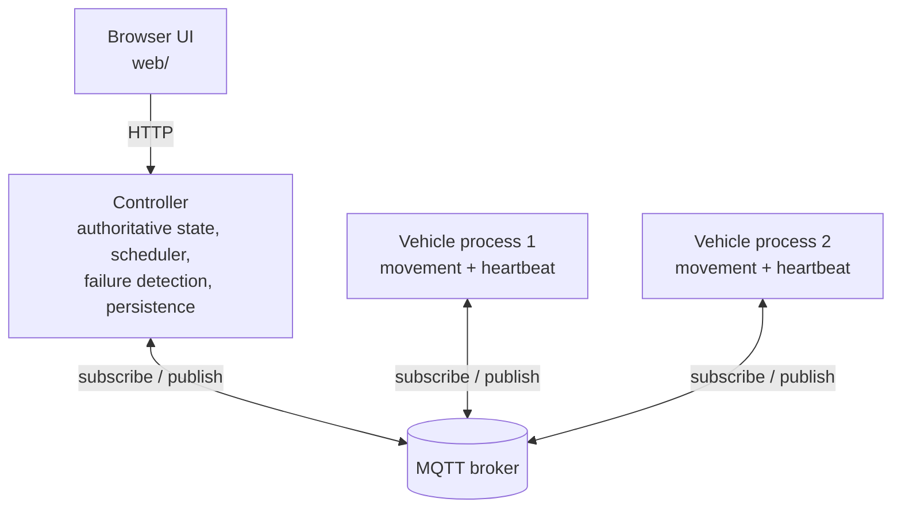

# Fault-Tolerant Fleet Manager

A small Go distributed-systems project that simulates vehicles completing tasks on a 2D grid. The focus is on coordination when messages are delayed, duplicated, dropped, or processes become unavailable—not on route optimization.

Vehicles and the controller communicate through an MQTT broker. A browser UI visualizes the simulation.

## Features

- Independent Go controller and vehicle processes
- MQTT publish/subscribe messaging with JSON payloads
- Vehicle movement and periodic heartbeat/position updates
- Task assignment and reassignment
- Heartbeat-based failure detection
- Message fault injection: drop, delay, duplicate, and reorder
- Controller state persistence and recovery
- Browser-based fleet visualization

## Architecture



The broker transports messages; it does not own fleet state. The controller is the source of truth for vehicle status, positions, task state, and assignments.

Typical message flow:

- Vehicles publish heartbeat messages, including their current position and sequence number.
- The controller consumes heartbeats, updates its state, and detects task completion or vehicle timeouts.
- The controller publishes task assignments and stop commands on vehicle-specific topics.
- The UI presents the current simulation state.

## Prerequisites

- [Go](https://go.dev/dl/) compatible with the version declared in [`go.mod`](go.mod)
- An MQTT broker, such as [Eclipse Mosquitto](https://mosquitto.org/)
- A modern browser for the UI

The commands below assume the broker is reachable at `localhost:1883`, which is the common local Mosquitto address. If your broker uses another address, configure the application accordingly.

## Build and run

Run these commands from the repository root.

### 1. Start an MQTT broker

If Mosquitto is installed locally, start it using your operating system's service manager or run:

```bash
mosquitto -v
```

Keep the broker running in its own terminal. If you use a broker running elsewhere, make sure the controller and vehicles are configured to connect to it.

### 2. Build the Go programs

```bash
go mod download
go build ./...
```

To run the programs directly without producing binaries:

```bash
go run ./cmd/controller
```

In a separate terminal, start a vehicle:

```bash
go run ./cmd/vehicle
```

Start additional vehicle processes in separate terminals if the application configuration permits multiple instances. If a command requires arguments or environment variables in your checkout, use the options defined by that command's entry point.

### 3. Open the web UI

From the repository root, start a simple static file server:

```bash
python3 -m http.server 8000
```

Then open <http://localhost:8000/web/> in your browser. The UI must be able to reach the controller's HTTP endpoint; adjust the UI or controller configuration if you have changed the endpoint. Keep the static server running in its own terminal.

## Configuration and message flow

Messages are JSON payloads carried over MQTT topics. The documented topic pattern is:

| Direction | Topic | Purpose |
|---|---|---|
| Vehicle → controller | `heartbeat/{vehicle_id}` | Heartbeat, position, and sequence number |
| Controller → vehicle | `task/{vehicle_id}` | Task assignment and assignment generation |
| Controller → vehicle | `stop/{vehicle_id}` | Stop an obsolete assignment |

See the source under [`src/`](src/) for the current implementation and configuration details.

## Tests

Run the Go test suite from the repository root:

```bash
go test ./...
```

For more detail on a failing test:

```bash
go test -v ./...
```

## Repository layout

```text
cmd/
  controller/   Controller entry point
  vehicle/      Vehicle entry point
src/
  controller/   Fleet state, scheduling, HTTP interface
  domain/       Shared domain types
  fault/        Message fault injection
  mqtt/         MQTT client integration
  vehicle/      Vehicle simulation
web/
  index.html    Browser UI
```

## Scope

This is an educational distributed-systems simulation. It deliberately keeps the vehicle domain simple so the project can focus on message delivery, failure detection, stale updates, task reassignment, and recovery. It is not a production fleet-control or physical-safety system.
