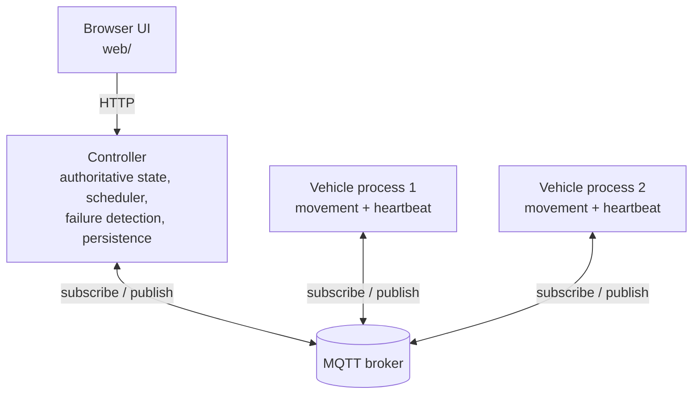

# Fault-Tolerant Fleet Manager

A small Go distributed-systems project that simulates vehicles completing tasks on a 2D grid. The focus is on coordination when messages are delayed, duplicated, dropped, or processes become unavailable—not on route optimization.

Vehicles and the controller communicate through an MQTT broker. A browser UI visualizes the simulation.

## Features

- Independent Go controller and vehicle processes
- MQTT publish/subscribe messaging with JSON payloads
- Vehicle movement and periodic heartbeat/position updates
- Task assignment and reassignment
- Heartbeat-based failure detection
- Message fault injection: drop, delay, duplicate, and reorder
- Controller state persistence and recovery
- Browser-based fleet visualization

## Architecture



The broker transports messages; it does not own fleet state. The controller is the source of truth for vehicle status, positions, task state, and assignments.

Typical message flow:

- Vehicles publish heartbeat messages, including their current position and sequence number.
- The controller consumes heartbeats, updates its state, and detects task completion or vehicle timeouts.
- The controller publishes task assignments and stop commands on vehicle-specific topics.
- The UI presents the current simulation state.

## Quick start (Docker)

The only requirements are [Docker](https://docs.docker.com/get-docker/) with Compose and a modern browser. From the repository root:

```bash
docker compose up --build
```

This builds the Go programs and starts the MQTT broker, the controller, three vehicles, and the web UI. Then open <http://localhost:8000>. The controller's HTTP API is published on <http://localhost:8080>.

Stop everything with `Ctrl+C`, and remove the containers with `docker compose down`.

## Scenarios

A scenario is a JSON file in [`scenarios/`](scenarios/) that defines where the vehicles start, which tasks exist, and which messages to drop, delay, or duplicate. The controller and every vehicle load the same file. Without further configuration, [`scenarios/no_faults.json`](scenarios/no_faults.json) runs.

### Run a scenario

Pick a scenario with the `SCENARIO` environment variable, as a path relative to the repository root:

```bash
SCENARIO=scenarios/task-hot-potato.json docker compose up --build
```

Then open <http://localhost:8000>. The `scenarios/` directory is mounted into the containers, so editing a scenario file does not need `--build`. The controller and the vehicles keep their state in memory, so run `docker compose down` before repeating or switching a scenario to start from scratch:

```bash
docker compose down
SCENARIO=scenarios/zombie-steals-completion.json docker compose up
```

To pin a scenario, put `SCENARIO=scenarios/<file>.json` in a `.env` file next to `docker-compose.yml`.

Without Docker, pass `-scenario scenarios/<file>.json` to the controller and to every vehicle.

Compose starts the controller and the vehicles at the same time. A heartbeat that a vehicle sends before the controller has subscribed is lost, which shifts that vehicle's registration by about a second and can change how a scenario plays out. If a run does not match its description, run `docker compose down` and start it again.

### Scenario file format

```json
{
  "vehicles": [
    { "id": "vehicle-1", "start_x": 10, "start_y": -10 }
  ],
  "tasks": [
    { "id": "task-1", "destination": { "x": 10, "y": 5 } }
  ],
  "controller_faults": [
    { "action": "drop", "vehicle_id": "vehicle-1", "sequence": 1 }
  ],
  "vehicle_faults": [
    { "action": "delay", "vehicle_id": "vehicle-1", "sequence": 3, "delay_ms": 2000 }
  ]
}
```

| Field | Meaning |
|---|---|
| `vehicles` | Start position per vehicle ID. A vehicle that is not listed starts at the `-startX`/`-startY` flags (default `0,0`). |
| `tasks` | Tasks created when the controller starts, each with a destination on the grid. |
| `controller_faults` | Faults on messages the controller sends to vehicles: task assignments and stop commands. `sequence` counts those messages per vehicle, starting at 1. |
| `vehicle_faults` | Faults on heartbeats a vehicle sends. `sequence` is the heartbeat number, starting at 1. |

Each fault has an `action` (`drop`, `delay`, or `duplicate`) and optionally:

- `vehicle_id`: the vehicle the rule applies to. Empty means all vehicles.
- `sequence`: the message the rule applies to. Omitted or `0` means every message.
- `delay_ms`: required for `delay` and must be greater than 0.

If several rules match one message, `drop` wins over `delay`, and `delay` wins over `duplicate`. A rule with a `sequence` affects exactly one message, so a longer outage is written as one rule per heartbeat.

Timing to keep in mind when reading a scenario:

- A vehicle moves one cell per second, first along x, then along y, and sends a heartbeat every second. Heartbeat *N* leaves about *N* − 1 seconds after the vehicle starts.
- The controller marks a vehicle `OFFLINE` after more than 3 seconds without a heartbeat and puts its task back in the queue.
- The controller assigns queued tasks to the nearest idle vehicle every 0.5 seconds.

### Reading the web UI

The UI shows the controller's view, not the vehicles' real state.

- The **Vehicles** table lists each vehicle's last reported position, its status (`IDLE`, `WORKING`, or a red `OFFLINE`), and the task the controller thinks it has.
- The **Tasks** table lists each task's status (`QUEUED`, `IN_PROGRESS`, `COMPLETED`) and the vehicle it is assigned to.
- On the grid, every vehicle is a coloured circle. While the controller thinks a vehicle is working on an in-progress task, a line leads from the vehicle to the task's ✕.

The UI does not show assignment generations or who completed a task. Follow the controller log for that:

```bash
docker compose logs -f controller
```

### Included scenarios

| Scenario | Faults | What it exposes |
|---|---|---|
| [`zombie-steals-completion`](scenarios/zombie-steals-completion.json) | One vehicle's heartbeats are lost for 6 s | A revived vehicle finishes a task that was reassigned, and the replacement is never released |
| [`task-hot-potato`](scenarios/task-hot-potato.json) | Two vehicles go silent one after the other | A task changes hands three times and two vehicles drive to the same cell |
| [`stale-assignment-after-takeover`](scenarios/stale-assignment-after-takeover.json) | A delayed assignment, a late vehicle, a lost heartbeat | An obsolete assignment is executed because the retry went to a different vehicle |
| [`unresponsive-vehicles`](scenarios/unresponsive-vehicles.json) | One vehicle cannot be heard, one cannot hear | A retry storm that one healthy vehicle has to absorb |
| [`heartbeat-loss-staircase`](scenarios/heartbeat-loss-staircase.json) | 2, 3, and 6 lost heartbeats on three vehicles | Where the failure detector trips, and what a short flap costs |

For each scenario, **Expected** is the behaviour a correct controller should show, and **Observed today** is what the current implementation does. The observed behaviour is the failure each scenario is built to expose, so those notes will change as fixes land. Times are approximate and measured from startup.

#### `zombie-steals-completion`

**Setup.** task-1 at (10, 2) is closest to vehicle-1, task-2 at (20, 0) is closest to vehicle-2, and vehicle-3 is the spare. vehicle-1's heartbeats 3 to 8 are dropped. It keeps driving and still receives commands.

**Expected.** vehicle-1 is declared offline and task-1 goes to vehicle-3. When vehicle-1's heartbeats return, the controller reconciles: one vehicle keeps task-1, the other is stopped, and the task completes exactly once.

**Observed today.** The revived vehicle-1 walks to (10, 2) and the controller marks task-1 completed, credited to vehicle-3. Nothing stops vehicle-3, which drives to (10, 2) and stays `WORKING` on a completed task forever, so the fleet is permanently one vehicle short. The controller looks the task up through `vehicle.CurrentTask`, which is not cleared when a vehicle goes offline, and never checks `task.AssignedVehicle`.

**On the website.** After about 5 s vehicle-1 turns red and its position freezes, and task-1 switches to `→ vehicle-3`. vehicle-1 then returns to `IDLE` but keeps moving toward (10, 2), so two lines run to the same ✕. Around 14 s task-1 turns `COMPLETED` while still listed under vehicle-3. vehicle-3 keeps driving, parks at (10, 2) at about 29 s, and stays `WORKING` on `task-1`.

#### `task-hot-potato`

**Setup.** One task at (40, -8). vehicle-1 is closest, then vehicle-2, then vehicle-3. vehicle-1's heartbeats 3 to 8 are dropped, then vehicle-2's heartbeats 9 to 14.

**Expected.** Only one vehicle owns the task at any time. When a previous owner reappears it is told to stop. vehicle-3 is never needed.

**Observed today.** The task goes to vehicle-1, then vehicle-2. When vehicle-2 goes dark, the nearest idle vehicle is the revived vehicle-1, so the task goes back to it. The revived vehicle-2 is reported `IDLE` but keeps driving to the same destination and arrives about 10 s after vehicle-1 has completed the task.

**On the website.** The assignment in the Tasks table changes from `→ vehicle-1` to `→ vehicle-2` and back to `→ vehicle-1`. Each owner turns red with a frozen position while it is silent. A vehicle that comes back reads `IDLE` but still lists `task-1`, and its circle keeps heading for (40, -8), so two lines run to the same ✕. vehicle-3 never moves. vehicle-1 finishes at about 35 s, and vehicle-2 arrives at about 45 s with nothing in the tables changing except its position.

#### `stale-assignment-after-takeover`

**Setup.** One task at (-6, -10), 6 cells from vehicle-3 and 16 from vehicle-1. vehicle-3's first heartbeat is dropped, so it registers a second late and vehicle-1 gets the first assignment. The controller delays that assignment by 5 s, and vehicle-1's heartbeat 2 is dropped.

**Expected.** When the delayed assignment finally arrives, it is recognised as obsolete, because vehicle-3 has already completed the task. vehicle-1 stays where it is.

**Observed today.** After about 2 s the controller concludes that the assignment was lost and re-assigns the task to vehicle-3, which completes it. When the original assignment reaches vehicle-1, it accepts it: its generation check only compares against assignments that vehicle itself has seen, and it never saw the newer one. It walks 16 cells to (-6, -10) while the controller lists it as `IDLE`.

**On the website.** task-1 is first assigned to vehicle-1, which does not move. After about 2 s the task switches to vehicle-3, which walks 6 cells west and completes the task at about 8 s. All vehicles read `IDLE`, yet from about 6 s vehicle-1's circle slides west the full 16 cells and arrives at about 26 s at the same spot as vehicle-3. It shows no line and no task.

#### `unresponsive-vehicles`

**Setup.** Four tasks near the start area. vehicle-1 is mute: its heartbeats 2 to 50 are dropped, but it still receives commands. vehicle-2 is deaf: every controller message to it is dropped, but its heartbeats arrive. vehicle-3 is healthy.

**Expected.** All four tasks complete. The controller notices that vehicle-2 never acknowledges an assignment and stops sending it work, and it copes with vehicle-1's silence without doing the work twice. The number of retries stays modest.

**Observed today.** All tasks complete after about 50 s, but only after a retry storm: around 55 assignment messages for 4 tasks, with one task's generation reaching about 22. vehicle-2 is the nearest idle vehicle on every cycle, so it keeps winning tasks and silently failing them. vehicle-1 is declared offline after its first heartbeat and works unseen. When its heartbeats resume it can complete a task that another vehicle still holds, which leaves that vehicle stuck `WORKING` (vehicle-2 in one observed run). vehicle-3 does most of the work, one task at a time.

**On the website.** vehicle-1 turns red within about 5 s and stays frozen at (10, -10) for around 45 s even though it is driving, then jumps to its real position when its heartbeats resume. vehicle-2 never leaves (20, 10). Its row flickers between `WORKING` and `IDLE` every second or two, and tasks in the Tasks table keep flipping between `→ vehicle-2` and `QUEUED`. vehicle-3 visibly does the work and completes the tasks one after another.

#### `heartbeat-loss-staircase`

**Setup.** Three long tasks, each clearly closest to one vehicle: vehicle-1 drives to (10, -35), vehicle-2 to (45, 10), and vehicle-3 to (-25, -10). The outages are staggered: vehicle-1 loses heartbeats 6 and 7, vehicle-2 loses 12 to 14, and vehicle-3 loses 18 to 23.

**Expected.** Heartbeats are 1 s apart and the timeout is 3 s. Two lost heartbeats leave a gap of about 3 s and are tolerated, while three lost heartbeats trip the detector. A short flap should be cheap: the vehicle comes back and continues its own task.

**Observed today.** vehicle-1 never goes offline. vehicle-2 is offline for under a second, and vehicle-3 for about 3 s. In both cases the task is requeued and given back to the same vehicle. Everything completes at about 26 s. Nothing leaks only because no vehicle is idle during the flaps. With an idle spare, a flap would turn into `zombie-steals-completion`.

**On the website.** vehicle-1 appears to stall for about 2 s and then jumps about 3 cells, but never turns red. vehicle-2 flashes red for less than a second at about 13 s, and task-2 is briefly `QUEUED`. vehicle-3 turns red for about 3 s at about 20 s, frozen, then jumps about 7 cells, and task-3 goes through `QUEUED` and back. All three tasks are `COMPLETED` at about 26 s.

## Run without Docker

### Prerequisites

- [Go](https://go.dev/dl/) compatible with the version declared in [`go.mod`](go.mod)
- An MQTT broker, such as [Eclipse Mosquitto](https://mosquitto.org/)
- [Docker](https://docs.docker.com/get-docker/) with Compose, to serve the web UI
- A modern browser for the UI

The commands below assume the broker is reachable at `localhost:1883`, which is the common local Mosquitto address. If your broker uses another address, configure the application accordingly.

Run these commands from the repository root.

### 1. Start an MQTT broker

If Mosquitto is installed locally, start it using your operating system's service manager or run:

```bash
mosquitto -v
```

Keep the broker running in its own terminal. If you use a broker running elsewhere, make sure the controller and vehicles are configured to connect to it.

### 2. Build the Go programs

```bash
go mod download
go build ./...
```

To run the programs directly without producing binaries:

```bash
go run ./cmd/controller
```

In a separate terminal, start a vehicle:

```bash
go run ./cmd/vehicle
```

Start additional vehicle processes in separate terminals if the application configuration permits multiple instances. If a command requires arguments or environment variables in your checkout, use the options defined by that command's entry point.

### 3. Open the web UI

The UI is served by the `web` service in [`docker-compose.yml`](docker-compose.yml), an nginx container serving the contents of `web/`:

```bash
docker compose up -d web
```

Then open <http://localhost:8000> in your browser. The UI polls the controller at `http://localhost:8080/api/state`, so the controller must be running and reachable on port 8080. Stop the UI with `docker compose stop web`.

## Configuration and message flow

Messages are JSON payloads carried over MQTT topics. The documented topic pattern is:

| Direction | Topic | Purpose |
|---|---|---|
| Vehicle → controller | `heartbeat/{vehicle_id}` | Heartbeat, position, and sequence number |
| Controller → vehicle | `task/{vehicle_id}` | Task assignment and assignment generation |
| Controller → vehicle | `stop/{vehicle_id}` | Stop an obsolete assignment |

See the source under [`src/`](src/) for the current implementation and configuration details.

## Tests

Run the Go test suite from the repository root:

```bash
go test ./...
```

For more detail on a failing test:

```bash
go test -v ./...
```

## Repository layout

```text
cmd/
  controller/   Controller entry point
  vehicle/      Vehicle entry point
src/
  controller/   Fleet state, scheduling, HTTP interface
  domain/       Shared domain types
  fault/        Message fault injection
  mqtt/         MQTT client integration
  vehicle/      Vehicle simulation
scenarios/
  *.json        Scenario files: start positions, tasks, fault rules
web/
  index.html    Browser UI
```

## Scope

This is an educational distributed-systems simulation. It deliberately keeps the vehicle domain simple so the project can focus on message delivery, failure detection, stale updates, task reassignment, and recovery. It is not a production fleet-control or physical-safety system.
